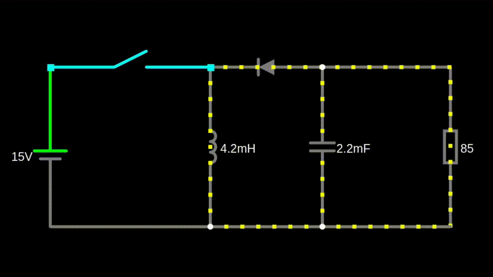
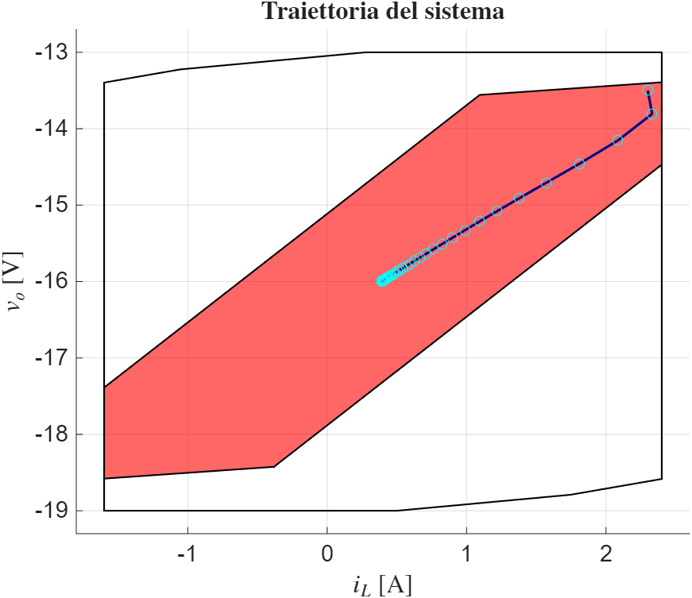
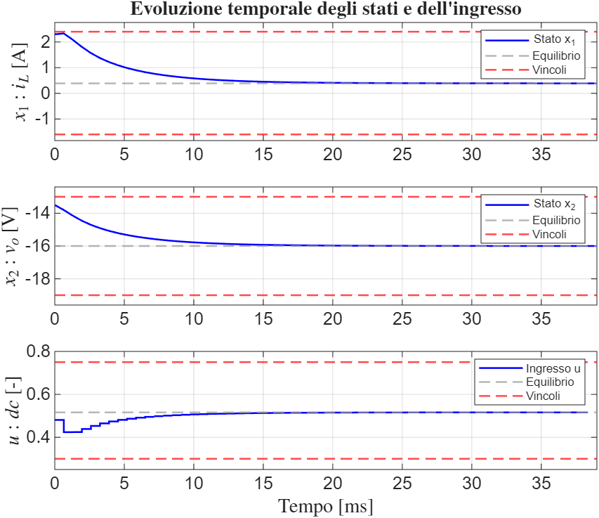

# ⚡ MPC per un DC-DC Boost Converter
### *Controllo Avanzato Multivariabile - 2026*

## 📄 Descrizione

  

> Simulazione del circuito del convertitore DC-DC boost controllato, realizzata mediante il simulatore online Falstad Circuit Simulator.

Il progetto sviluppa un **Model Predictive Control (MPC) lineare** che regola la tensione di uscita di un **DC-DC boost converter** agendo sul **duty cycle** del transistor. In questo convertitore la tensione di uscita ha segno opposto a quella di ingresso.

Il controllore è progettato sul modello linearizzato e validato sull'**impianto non lineare a tempo discreto**, rispettando sempre i vincoli fisici su corrente, tensione e duty cycle.

## 🎯 Obiettivi

* **Portare** il sistema da $(i_L, v_o) = (2.3\text{ A}, -13.5\text{ V})$ all'equilibrio $(0.389\text{ A}, -16\text{ V})$, con $\bar{d}_c = 0.516$.
* **Confrontare** due ingredienti terminali: vincolo di **disuguaglianza** (CIS + costo terminale) e vincolo di **uguaglianza** ($x(N) = 0$).
* **Analizzare** l'effetto dei pesi $Q$ e $R$, dell'orizzonte $N$ e del tempo di campionamento $T$.

## 🧠 Modello e metodo

Stati: corrente di induttore $x_1 = i_L$ e tensione di uscita $x_2 = v_o$. Ingresso: duty cycle $u = d_c$.

$$x_1(k+1) = x_1(k) + \frac{T}{L}x_2(k) - \frac{T}{L}\big(x_2(k) - V_{in}\big)u(k)$$
$$x_2(k+1) = -\frac{T}{C}x_1(k) + \frac{T}{C}x_1(k)u(k) + \left(1 - \frac{T}{RC}\right)x_2(k)$$

**Vincoli:** $-1.6 \le i_L \le 2.4$ A, $-19 \le v_o \le -13$ V, $0.3 \le d_c \le 0.75$.
**Parametri:** $T = 0.65$ ms, $L = 4.2$ mH, $C = 2200$ µF, $R = 85$ Ω, $V_{in} = 15$ V.

1. **Linearizzazione** attorno all'equilibrio e riformulazione come **QP condensato**.
2. **Receding horizon:** a ogni passo il QP è risolto con `quadprog` e si applica solo il primo ingresso all'impianto non lineare.
3. **Ingredienti terminali:** variante **A** con $x(N) \in$ CIS (legge LQR) e costo terminale $P$ da Riccati, variante **B** con $x(N) = 0$.
4. **Fattibilità** verificata con l'**N-step controllable set**.

## 📊 Risultati

  
  

* Entrambe le varianti raggiungono l'equilibrio in **≈ 15 ms** senza **mai violare i vincoli**.
* Il **CIS** garantisce fattibilità anche con $N = 1$, mentre il vincolo di uguaglianza richiede $N \ge 16$.
* La leva di taratura efficace è **R**: aumentandolo la risposta diventa più dolce e poi lenta e oscillante. $Q$ ha effetto trascurabile.
* Un **T più lungo** peggiora la risposta: compaiono sottoelongazioni e l'assestamento sale a ≈ 40 ms.

Tutti i grafici sono in [`results/`](results), l'analisi completa nella [presentazione](doc/Presentazione_MPC_Boost_Converter.pptx).

## 🚀 Come eseguirlo

Apri MATLAB nella cartella `code/` e lancia `main_ineq.m` (variante **A**) oppure `main_eq.m` (variante **B**). I parametri sono all'inizio di ogni script.

## 🛠️ Tecnologie

* **Linguaggio:** MATLAB
* **Toolbox:** Optimization Toolbox (`quadprog`), Control System Toolbox (`dlqr`), [MPT3](https://www.mpt3.org)

## 👨‍💻 Team

| Nome | Matricola | GitHub |
|------|-----------|--------|
| Daniele Gotti | 1079011 | [@DanieleGotti](https://github.com/DanieleGotti) |
| Riccardo Motta | 1093277 | [@r-motta](https://github.com/r-motta) |
